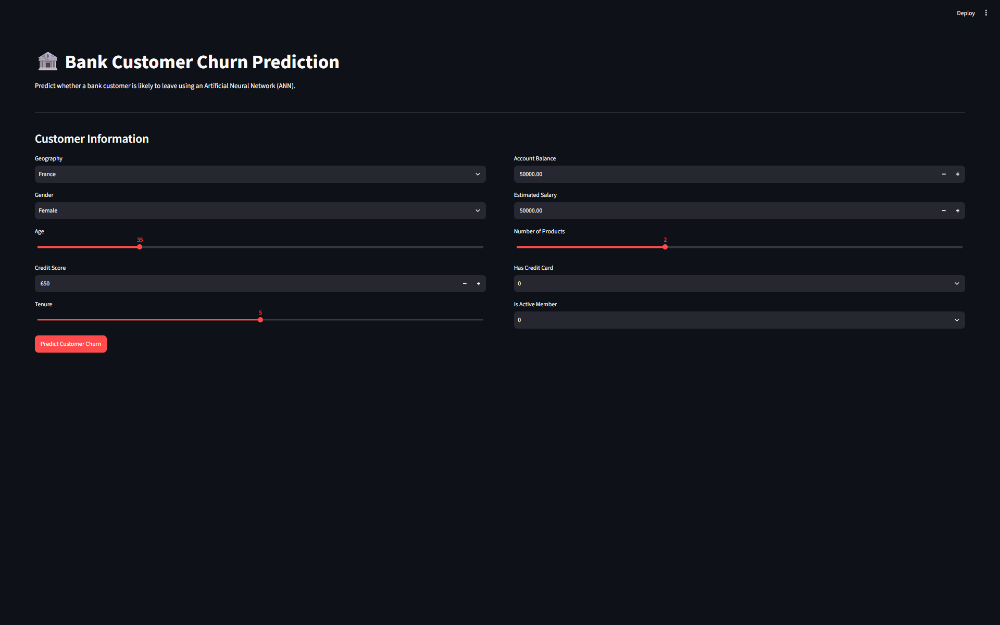
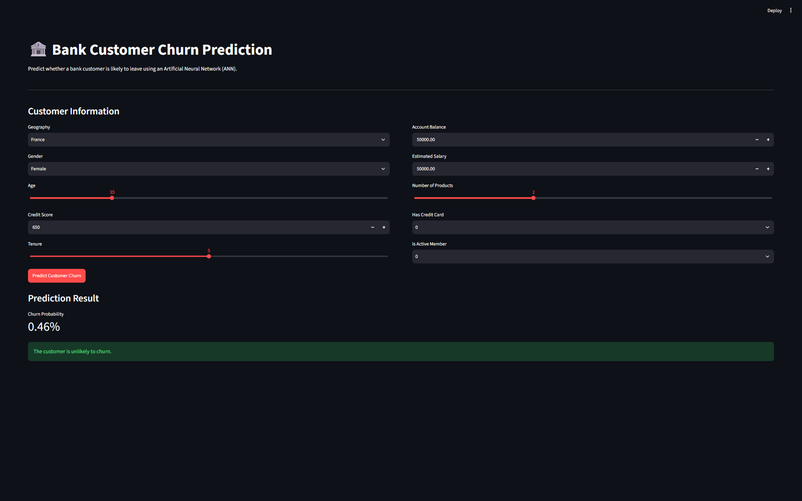
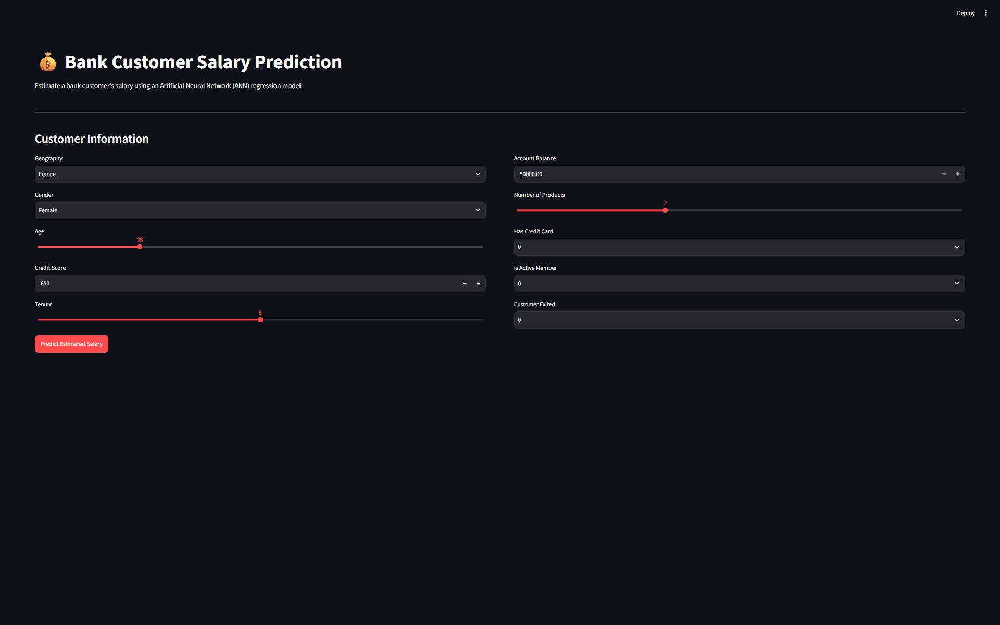
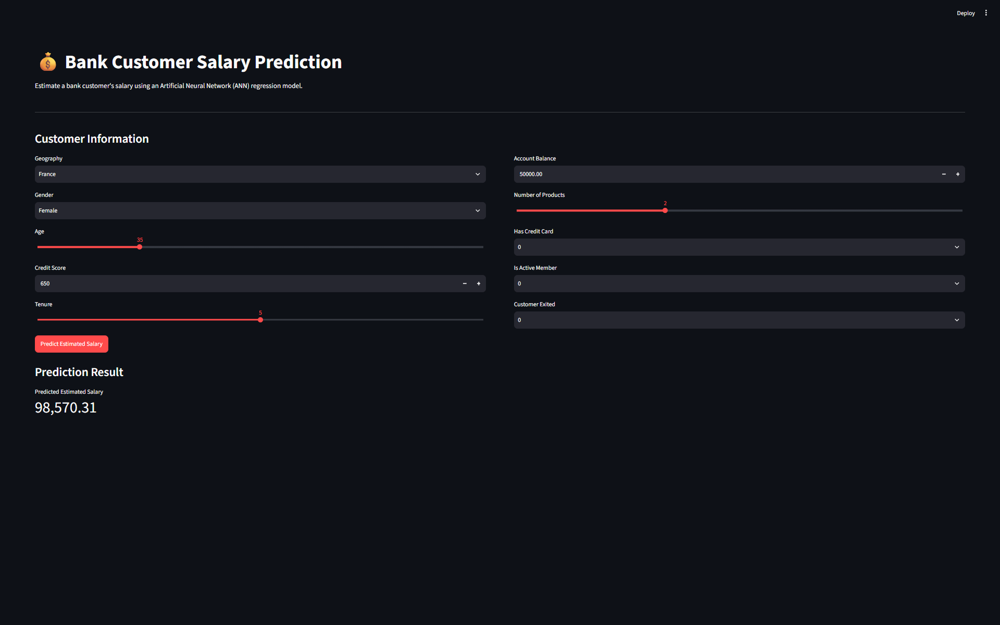

# Artificial Neural Network (ANN) Projects — Classification & Regression

A collection of deep learning projects demonstrating **binary classification and regression using Artificial Neural Networks (ANNs)**, developed with TensorFlow/Keras, Scikit-learn, and Streamlit.

This repository contains two applications:

1. **Bank Customer Churn Prediction** — Predicts whether a customer is likely to leave a bank.
2. **Customer Estimated Salary Prediction** — Estimates a numerical salary using customer information.

## Project 1: Bank Customer Churn Prediction

### Overview

This project uses an Artificial Neural Network to predict customer churn based on customer demographics, account information, and banking activity.

**Problem Type:** Binary Classification

**Target Variable:** `Exited`

### Application Screenshots

**Customer Information Form**



**Churn Prediction Result**



### Key Features

- Data preprocessing and categorical encoding
- Feature scaling using StandardScaler
- ANN development using TensorFlow/Keras
- Binary classification using a sigmoid output layer
- EarlyStopping to reduce overfitting
- TensorBoard experiment visualization
- Hyperparameter tuning using SciKeras and GridSearchCV
- Interactive Streamlit application

### Model Architecture

The main training notebook explores ANN architectures using:

- Dense hidden layers with ReLU activation
- Sigmoid output activation
- Binary Cross-Entropy loss
- Adam optimizer

The hyperparameter-tuning notebook experiments with hidden-layer counts, neuron counts, and training epochs.

## Project 2: Customer Estimated Salary Prediction

### Overview

This project demonstrates ANN-based regression to estimate a customer's salary from banking and demographic features.

**Problem Type:** Regression

**Target Variable:** `EstimatedSalary`

### Application Screenshots

**Customer Information Form**



**Salary Prediction Result**



### Key Features

- Categorical feature encoding
- Numerical feature scaling
- ANN regression using TensorFlow/Keras
- Linear output layer for numerical predictions
- Mean Absolute Error (MAE) loss
- EarlyStopping and TensorBoard
- Interactive Streamlit application

### Model Evaluation

The recorded notebook evaluation reports a test MAE of approximately **49,906.72** in the dataset's salary units.

This is an experimental regression model. Its prediction error is substantial, so the application should be considered a learning demonstration rather than a reliable salary-estimation tool.

## Technologies Used

| Category | Technologies |
|---|---|
| Programming | Python |
| Deep Learning | TensorFlow, Keras |
| Machine Learning | Scikit-learn, SciKeras |
| Data Processing | Pandas, NumPy |
| Experimentation | Jupyter Notebook, TensorBoard |
| Hyperparameter Tuning | GridSearchCV |
| Web Application | Streamlit |
| Model Storage | H5, Pickle |
| Version Control | Git, GitHub |

## Project Structure

```text
ANN-Classification/
│
├── data/
│   └── Churn_Modelling.csv
│
├── customer_churn_classification/
│   ├── app.py
│   ├── experiments.ipynb
│   ├── hyperparametertuning.ipynb
│   ├── prediction.ipynb
│   ├── model.h5
│   ├── label_encoder_gender.pkl
│   ├── onehot_encoder_geo.pkl
│   └── scaler.pkl
│
├── salary_regression/
│   ├── streamlit_regression.py
│   ├── salaryregression.ipynb
│   ├── salary_model.h5
│   ├── label_encoder_gender_salary.pkl
│   ├── onehot_encoder_geo_salary.pkl
│   └── scaler_salary.pkl
│
├── screenshots/
│   ├── churn-form.png
│   ├── churn-result.png
│   ├── salary-form.png
│   └── salary-result.png
│
├── requirements.txt
└── README.md
```

Additional tuning artifacts and TensorBoard logs may also be present in the repository.

## Installation and Setup

### Clone the Repository

```bash
git clone https://github.com/shammi00/ANN-Classification.git
cd ANN-Classification
```

### Install Dependencies

Use a compatible Python environment and install the required packages:

```bash
pip install -r requirements.txt
```

### Run Customer Churn Classification

```bash
streamlit run customer_churn_classification/app.py
```

### Run Salary Regression

```bash
streamlit run salary_regression/streamlit_regression.py
```

Streamlit will launch the selected application in your browser.

## Learning Outcomes

Through these projects, I gained practical experience in:

- Understanding classification and regression in deep learning
- Building and training Artificial Neural Networks
- Designing hidden layers and choosing activation functions
- Applying feature encoding and scaling
- Using training and validation datasets
- Implementing EarlyStopping
- Monitoring training using TensorBoard
- Experimenting with neural network hyperparameters
- Saving and loading trained models
- Integrating deep learning models with Streamlit applications
- Organizing multiple experiments in a structured repository

## Future Improvements

- Evaluate the classification model on a held-out test set
- Improve the salary regression model and compare against baseline models
- Make preprocessing pipelines more reproducible
- Add automated application tests
- Improve deployment readiness

## Author

**Shammi Kumar Singh**

B.Tech — Artificial Intelligence & Machine Learning

Malla Reddy University

**GitHub:** https://github.com/shammi00

**LinkedIn:** https://www.linkedin.com/in/shammikumarsingh